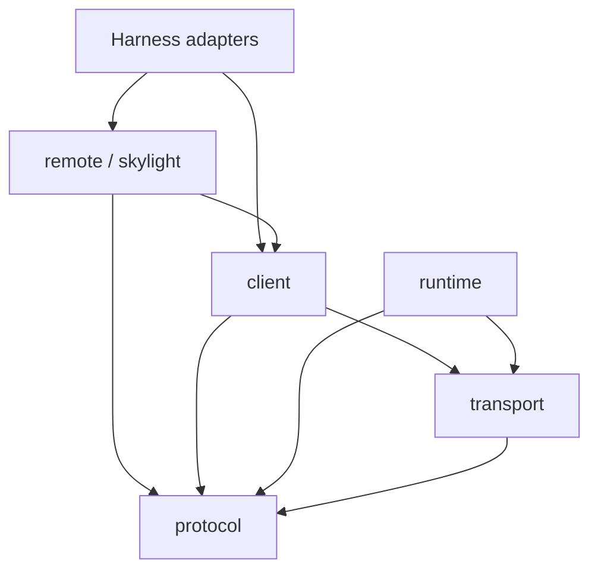
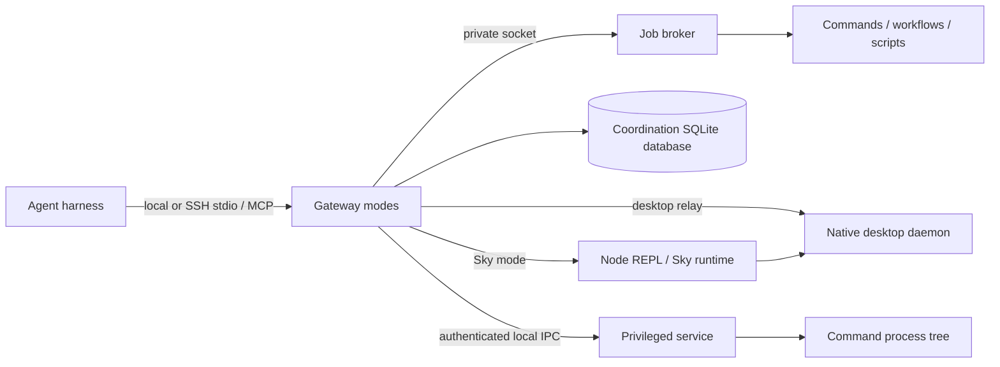

# Setup and development

<!-- rumdl-disable MD033 -->

> [!CAUTION]
>
> <h1>☢️ ☣️ NUCLEAR SLOP CONTAINMENT ZONE ☣️ ☢️</h1>
>
> <h2>🩷 Dear human, please head back to the
> <a href="../README.md">README</a></h2>
>
> <h2>🚨 PURE AI SLOP, WRITTEN BY AI FOR AI 🚨</h2>
>
> This guide is AI-generated setup and development instructions for agents
>
> Save your time. Let a dumb little token-gobbling clanker waste its time
> (compute) here instead
>
> It made this mess. It can choke on its own slop

<!-- rumdl-enable MD033 -->

Use this guide to set up the checkout, choose where a change belongs, and
maintain the installed tools. The [README](../README.md) explains why the
project exists.

- [Set up a checkout](#set-up-a-checkout)
- [Find commands](#find-commands)
- [Choose where a change belongs](#choose-where-a-change-belongs)
- [Farstep processes and recovery](#farstep-processes-and-recovery)
- [Build, check, and format changes](#build-check-and-format-changes)
- [Install packages and settings](#install-packages-and-settings)
- [Maintain OMP](#maintain-omp)
- [Build and deploy Farstep](#build-and-deploy-farstep)
- [Maintain ChatGPT and Sky](#maintain-chatgpt-and-sky)
- [Install and maintain Ghidra](#install-and-maintain-ghidra)
- [Update pins and generated files](#update-pins-and-generated-files)

Run commands from the repository root unless a step names another directory.
Paths in this guide are relative to that root. Before changing behavior, read
the relevant implementation and take version numbers from its manifests or pins.

## Set up a checkout

Use the Bun version declared in [package.json](../package.json) and Just 1.55.0
or newer. With Nix installed, open the development shell and install
dependencies:

```sh
just dev
just install
```

The shell supplies Bun, Rust, native build libraries, and the maintenance tools
listed in [dev.nix](../tools/nix/dev/dev.nix). To run one command inside it
without opening an interactive shell, use `just dev just check types`.

Prefer an available Linux machine for Linux builds and Nix work. Use macOS for
Darwin work.

Without the shell, install the declared Bun version, Just, and the tools needed
for the task, then run `just install`. OMP maintenance needs `curl`, `patch`,
and GNU tar. GitHub checks need actionlint and zizmor. Native builds need the
target platform's SDK and libraries.

`just install` prepares development dependencies with frozen lockfiles and
lifecycle scripts disabled. It installs the four root workspaces and the
separate tools in `tools/scripts/dependencies/`. It leaves CLI installation and
settings activation to the
[installation workflow](#install-packages-and-settings).

The root workspaces are `packages/core`, `apps/chatgpt`, `apps/omp`, and
`farstep`, which share `bun.lock`. The manifests in `tools/runtime/`,
`farstep/dependencies/`, and `apps/omp/runtime/upstream/` have separate
lockfiles for distribution inputs. Keep that distinction when updating
dependencies.

## Find commands

Use Just for development and maintenance tasks. The root
[Justfile](../Justfile) groups recipes from `tools/just/` into space-separated
subcommands:

| Command                                      | Use it to                           |
| -------------------------------------------- | ----------------------------------- |
| `just`                                       | List the command tree               |
| `just nix`                                   | List recipes in the Nix group       |
| `just help omp patches check`                | Read a recipe's implementation      |
| `just --dry-run nix build farstep --no-link` | Preview a recipe with its arguments |

Use the installed `ai` launcher for utilities such as browser inspection,
ChatGPT configuration, and Ghidra. `ai --help` lists commands, and
`ai GROUP --help` lists one group. For example:

```sh
ai browser chromium user agent --browser chromium
ai browser firefox user agent --browser firefox
ai ghidra macos find SkyLight
```

From a checkout, `tools/scripts/cli/ai.sh` runs that launcher through Nix. With
Bun dependencies installed, `bun tools/scripts/cli/cli.ts --help` lists its
routes directly. Read [cli.ts](../tools/scripts/cli/cli.ts) when adding a route.
Quote arguments that contain spaces or shell metacharacters.

## Choose where a change belongs

Keep machine behavior in Farstep and harness behavior in the app adapter. A
harness is the agent application, such as OMP. Its adapter connects Farstep's
machine APIs to the harness's tools, session state, and conversation UI.

For example, changing how a job runs belongs in Farstep. Changing how OMP shows
that job's completion belongs in `apps/omp/`. Generic utilities used by either
layer belong in `packages/core/`.

### Apps, settings, and build tools

| Path                                            | Responsibility                                                              |
| ----------------------------------------------- | --------------------------------------------------------------------------- |
| `packages/core/`                                | Generic tool contracts, schemas, Effect lifetimes, processes, observability |
| `apps/omp/extensions/`, `apps/omp/lib/`         | OMP tools, session policy, UI, and adapter helpers                          |
| `apps/omp/runtime/`                             | Upstream OMP pin, maintained patches, overlays, generated npm patches       |
| `apps/chatgpt/`                                 | App integration, plugin sync, node REPL, computer-use policy patcher        |
| `apps/codex/`, `apps/claude/`, `apps/opencode/` | CLI launchers and packages                                                  |
| `apps/browser/`, `apps/ghidra/`                 | Browser utilities, Ghidra runtime, API types, MCP launchers                 |
| `config/settings/`                              | Declared settings, host discovery, config exports                           |
| `tools/scripts/`, `tools/just/`, `tools/nix/`   | Maintenance scripts, recipes, builds, modules                               |
| `tools/runtime/`                                | Distribution dependencies and executable wrappers                           |

### Farstep layers

Farstep combines TypeScript orchestration with Rust desktop and privileged
backends. Use the layer that owns the behavior being changed:

| Path                                                | Responsibility                                                                          |
| --------------------------------------------------- | --------------------------------------------------------------------------------------- |
| `farstep/protocol/`                                 | Wire schemas, capabilities, limits, jobs, workflows, receipts                           |
| `farstep/transport/`                                | MCP connections, bounded framing, compression, desktop RPC, relay                       |
| `farstep/client/`                                   | Machine discovery, gateway clients, terminals, file transfers, desktop and Sky channels |
| `farstep/remote/`, `farstep/skylight/`              | Tools and agent guides that work across harnesses                                       |
| `farstep/runtime/`                                  | Machine-side entry points, jobs, coordination, Sky provisioning, platform activation    |
| `farstep/native/`                                   | Rust protocol, desktop runtime, OS backends, privileged service                         |
| `farstep/native/desktop/platform/linux/extensions/` | GNOME, KDE, native compositor, and nested desktop integrations                          |
| `farstep/packaging/`                                | Platform payload construction                                                           |
| `farstep/sky/`                                      | Generated declarations for the pinned upstream Sky API                                  |

### Imports and adapter boundaries

Runtime imports flow from apps to Farstep to core. Apps can also import core
directly. Farstep runtime code stays independent of app adapters, while
packaging can assemble files from several layers.

Within Farstep, the arrows below show which layers import which:



Protocol code defines the shared contracts without importing their clients or
implementations. Clients and runtime can both use transport, but they do not
import each other. This is why native desktop RPC lives in transport: both a
harness client and the machine's Sky bridge need to call the desktop daemon.
These layers can also use core and appropriate third-party libraries.

Use package exports when importing across workspaces, such as
`farstep/protocol/identity` or `@ai/core/tool/tool`. Within a workspace, use
short relative imports or its alias: `#core/*`, `#apps/omp/*`, or `#farstep/*`.

Keep launch and presentation choices in the adapter when using Farstep clients:

- Gateway clients negotiate RPC, acknowledge completions, and send coordination
  heartbeats. The adapter supplies the launch transport and delivers completions
  to the conversation.
- Desktop clients accept a channel key and a launcher. The adapter derives the
  key from its session, so the client needs no harness-specific session object.
- Scratch operations and helper probes accept `ScriptTransport`, which resolves
  a script into a command and arguments.
- Sudo execution handles credential framing, identity checks, and deadlines. The
  adapter supplies password prompts, session checks, reconnection, and output.
- File clients enforce transfer limits and hash checks. The adapter supplies the
  transfer mechanism and the harness's read and edit engines.

Keep selectors, rendering, artifact allocation, session records, and branch
policy in the adapter too. Keep machine-specific contracts in Farstep so core
remains reusable without depending on a machine or harness.

Run `just check architecture` after moving code or changing imports. Its
[rules](../tools/scripts/dependencies/cruiser.json) enforce layer boundaries,
reject unresolved imports and runtime cycles, and prevent Linux desktop
extensions from importing Node dependencies.

Check [Farstep's package exports](../farstep/package.json) before adding a
public entry point. The `farstep/cli` export lets launchers resolve the
executable without starting it as a side effect of importing it. The narrow
`farstep/runtime/sky/runtime/*` exports support maintenance scripts. When adding
a subprocess, also update [vite.config.ts](../farstep/vite.config.ts) so its
entry point is bundled even if no library imports it.

## Farstep processes and recovery

A persistent job can outlive the SSH connection that started it because the job
broker owns its process. The gateway only connects the harness to that broker.
Keep those lifetimes separate when changing execution or connection cleanup.

Each gateway process serves one connection mode. A harness can open several
gateways on the same machine:



### Resource ownership

The job broker in `farstep/runtime/jobs/broker/` owns processes, output logs,
terminal state, and completion records. Gateways connect through a private
authenticated socket. Persistent jobs keep the broker alive after clients leave,
and a new gateway can observe an existing job by identity. Preserve that
behavior alongside the broker's idle policy.

The coordination registry in `farstep/runtime/coordination/` records shared work
and presence leases in SQLite. The broker supplies process observations. An
expired presence lease therefore cannot establish that an OS process stopped.

The desktop runtime in `farstep/native/desktop-runtime/` owns capture sessions,
the control lease, and workspace leases. Closing a channel releases its sessions
and owned workspaces. Pointer requests carry frame IDs so the backend can reject
input aimed at a stale capture. OS implementations of these operations live in
`farstep/native/desktop/`.

The privileged service in `farstep/native/service/` owns elevated commands and
their process trees. The request budget, connection lifetime, and service stop
signal bound their execution. The service uses authenticated local IPC and runs
independently of the user's graphical session.

### Timeouts, delivery, and compatibility

A timeout does not establish whether an operation ran. The broker might have
accepted a command before the connection failed. Query the job, workflow state,
or action receipt before deciding whether to retry. Reconnecting must not replay
commands or desktop input automatically.

An RPC wait and a job deadline also have different effects. Ending the wait
stops waiting for a response. A persistent job continues until it finishes, its
deadline expires, or an explicit termination stops its owned process tree.

Completion delivery uses a separate acknowledgement. A notification remains
pending until the client delivers it and acknowledges its completion ID.
Preserve that ID across recovery, and let delivery callbacks handle duplicates.

Terminal-input acknowledgements describe what Farstep observed. A processed
action means Farstep accepted the input and observed a screen. The application
may still be waiting to consume the input, so the acknowledgement cannot prove
that an application action finished.

Negotiate the protocol major, installation identity, and required capabilities
before issuing operations. A helper's version string alone does not establish
which capabilities it supports.

Validate and bound data at every process boundary. Rust wire types in
`farstep/native/protocol/` and TypeScript schemas in `farstep/protocol/desktop/`
are maintained separately. Account for both when changing a field, limit, or
acceptance rule.

## Build, check, and format changes

Run checks that cover the changed files and behavior. For example, a TypeScript
change usually needs the relevant typecheck. Moving that code between layers
also needs `just check architecture`.

| Command                   | Scope                                                                |
| ------------------------- | -------------------------------------------------------------------- |
| `just check types`        | Root and all four Bun workspace typechecks                           |
| `just check biome`        | TypeScript, JavaScript, and JSON formatting and lint                 |
| `just check dependencies` | Unused, unlisted, and unresolved dependencies with Knip              |
| `just check architecture` | Runtime import boundaries and cycles                                 |
| `just check github`       | Actions syntax and offline security rules with actionlint and zizmor |
| `just check just`         | Root Justfile and recipe formatting                                  |
| `just check patches`      | OMP runtime and SDK profiles, including generated npm patches        |
| `just check sky`          | Tracked Sky declarations and metadata against local pins             |
| `just check rust`         | Rust formatting and Clippy across minimal features and the workspace |
| `just check powershell`   | PSScriptAnalyzer, requiring PowerShell and its analyzer module       |
| `bun run test`            | Existing core tests, including child-process execution               |
| `just check build`        | Root and workspace builds, including Linux desktop extension bundles |
| `just nix eval`           | Flake evaluation for all supported systems, without builds           |
| `just nix check`          | Evaluation for all systems, then checks built for the current system |

`just check` checks Just formatting and runs the root `check` script. PowerShell
and Nix checks run separately. The exact commands are in
[package.json](../package.json) and
[check.just](../tools/just/check/check.just).

Run existing tests as needed. Create or modify tests only when Evy asks. Report
which platform and behavior each check covered. For example, a macOS typecheck
does not check Linux desktop behavior. The
[CI workflow](../.github/workflows/ci.yml) runs workspace, process, native,
PowerShell, and Nix checks in separate jobs on supported runners.

### Build output and generated files

Use `just build` to build the root tools and all four workspaces with Vite.
For a focused build or typecheck, run `bun run build` or `bun run typecheck` in
the workspace directory.

Each build writes a `dist/` tree that mirrors source paths, with source maps and
runtime resources. Package dependencies remain external. Farstep also writes
`farstep/dist/extensions/`. Build selection and resource copying live in
[projects.ts](../tools/scripts/vite/projects.ts).

Edit maintained source files, then regenerate their derived output with the
owning maintenance command. Keep `dist/`, `target/`, `node_modules/`, and
`.generated/` as local output. Credentials, conversation history, databases,
sessions, personal records, and connection state belong outside the tracked
repository.

### Format source files

Use `nix fmt`, the repository's canonical formatter. `just fmt`, `just nix fmt`,
and `bun run format` invoke it. To format this guide alone:

```sh
just fmt all --no-cache docs/guide.md
```

To select a formatter instead, use `just fmt just` or `just fmt powershell`.
[fmt.nix](../tools/nix/fmt/fmt.nix) defines the formatters and exclusions.
Markdown uses rumdl with 80-column prose reflow and code-block tools disabled.
Use pandoc to parse Markdown and awk to check line widths, allowing wider code,
commands, URLs, and tables when their layout requires it.

The formatter excludes generated locks, dependency expressions, npm patches,
vendored sources, and ignored output. Rust uses the repository's nightly
formatting options. Files without a syntax formatter receive final-newline
normalization.

Treefmt's `--fail-on-change` formats the working copy before reporting changes.
Use the flake's `treefmt` check when the check must format a temporary copy.

## Install packages and settings

Install a Nix package for executables. Import a Nix module when the installation
also needs declared settings and session services. The flake supports
`x86_64-linux`, `aarch64-linux`, and `aarch64-darwin`.

### Install executables

To install the launcher bundle in the user profile:

```sh
nix profile add .#ai-tools
```

`just nix run ai-tools setup` installs the same launcher bundle, then installs
the selected upstream CLIs through Bun. Update the bundle itself with
`nix profile upgrade`, or update a declarative installation through the
consuming configuration's flake lock and activation. `AI_TOOLS_FLAKE` selects
the bundle source for profile installation. Nix builds the launchers and
integrations. Upstream CLI executables and the patched OMP runtime stay outside
the Nix store.

On every platform, `ai setup` and `ai update` install Codex from
`@openai/codex@alpha`, Claude from `@anthropic-ai/claude-code@latest`, and
OpenCode from `@opencode/cli@latest`. Updates resolve the channel, remove the
selected package if installed, reinstall it with fresh registry metadata, and
check its executable's version. Bun updates share a lock to prevent concurrent
changes to the global package installation. The launchers prefer Bun's global
binaries, then search the executable path. An explicit `CODEX_REAL_BIN`,
`CLAUDE_REAL_BIN`, or `OPENCODE_REAL_BIN` overrides that selection.

For example, `ai update codex` refreshes only Codex and runs
`codex app-server daemon update --from-cli --yes` using the installed Bun
binary when a daemon package exists. This pins the daemon to the CLI package
and can restart a running daemon. Fresh installations without a daemon skip
that step. Background updates on Windows update only the CLI package, leaving
the active daemon alone.

Claude uses the updated executable on its next launch. OpenCode's next client
connection replaces an outdated managed background service. The updater leaves
that replacement to OpenCode because an explicit `service restart` also shuts
down persistent terminals.

OMP keeps its patched pin. Setup, update, and launch prepare that pinned runtime
with Bun in the user cache on every platform. Run `just omp update VERSION` to
change the pin, then update the launcher bundle and launch OMP again.
Pass `--dry-run` to inspect package commands without changing anything. The
implementation lives in [setup.ts](../tools/scripts/setup/setup.ts).

To build a package without installing it, use a command such as
`just nix build farstep --no-link`. The main outputs are:

| Nix output       | Contents                                                                |
| ---------------- | ----------------------------------------------------------------------- |
| `ai-javascript`  | Typechecked root and workspace Vite output with production dependencies |
| `ai-tools`       | CLI launchers and integrations using that JavaScript output             |
| `farstep`        | Machine runtime, native components, and platform resources              |
| `farstep-native` | Rust desktop and privileged service executables                         |
| `ai-configs`     | Portable rendered settings                                              |
| `farstep-sky`    | Pinned Sky runtime on Linux x64 and macOS arm64                         |
| `chatgpt`        | ChatGPT app on macOS arm64                                              |
| `ghidra-mcp`     | Ghidra GUI, extension, headless backend, and bridge                     |

The default overlay exposes these packages as `pkgs.aiTools`. Its `easyOverlay`
builds them against the consumer's final Nixpkgs package set, so later overlays
affect their dependencies. Read
[packages.nix](../tools/nix/packages/packages.nix) when changing package
composition.

### Activate declared settings

In a consuming flake with this repository named `ai`, import the module for the
configuration being managed:

| Consumer     | Import                          | Manages                                                              |
| ------------ | ------------------------------- | -------------------------------------------------------------------- |
| Home Manager | `ai.homeManagerModules.default` | User packages, settings, integrations, session services              |
| NixOS        | `ai.nixosModules.default`       | System packages, with Home Manager used separately for user settings |
| nix-darwin   | `ai.darwinModules.default`      | Packages and optional primary-user settings                          |

The same modules are available as `ai.modules.homeManager.default`,
`ai.modules.nixos.default`, and `ai.modules.darwin.default`. Those exports check
the module class. Their aliases are defined in
[modules.nix](../tools/nix/flake/modules.nix).

Set `programs.ai.enable` to enable Claude, Codex, OpenCode, OMP, Farstep, and
Ghidra by default. Override each `programs.ai.<tool>.enable` independently to
choose another combination. Enable ChatGPT and
`programs.ai.farstep.desktop.enable` separately. The options live in
[common.nix](../tools/nix/common/common.nix).

The integrations extend upstream `programs.codex`, `programs.claude-code`,
`programs.opencode`, and `programs.mcp.servers`. Use a Home Manager input that
supports the Codex profiles and writable-settings options used here. The
repository pins a compatible input. Keep the consuming configuration's host and
state-version declarations.

The upstream Home Manager package options default to `null`. Use `ai setup` or
`ai update` to install upstream CLIs through Bun and prepare OMP's patched
runtime in the user cache. The consumer's Nixpkgs policy must allow unfree
`farstep-sky` and `chatgpt` packages when included.

### Settings merges and client behavior

Activation merges declared Codex, Claude, and OMP settings into writable files.
Declared values replace existing values, while undeclared values remain.
OMP keeps MCP configuration in `~/.omp/agent/mcp.json`, separate from its agent
settings. Set `programs.ai.omp.mutableSettings` to `false` for immutable OMP
settings instead.

Farstep registers desktop and system MCP servers. Shared MCP declarations also
supply Ghidra bridges to enabled clients. Codex's `safe` profile prompts for
shared tools, while `review` disables their servers. OpenCode writes shared
servers under `mcp.servers` and keeps CLI settings in a separate `cli.json`.

Claude's launcher exports `programs.ai.claude.environment`. Setting an entry to
`null` omits that default and preserves an inherited value. Its config directory
follows `home.preferXdgDirectories`. Override `programs.claude-code.configDir`
or set an absolute `CLAUDE_CONFIG_DIR` in the launcher environment to select
another directory.

### Activate a primary user's settings with nix-darwin

The Darwin adapter activates selected modules from the pinned Home Manager input
directly, without creating a Home Manager generation. Enable
`programs.ai.user.enable` to manage settings for `system.primaryUser`, and
declare that user's home through `users.users.<name>.home`. With the user option
enabled, activation merges settings and installs native LaunchAgents for enabled
services. Without it, the adapter installs packages.

Activation keeps managed paths inside the primary user's home. XDG paths follow
`home.preferXdgDirectories` and `xdg.configHome`. An unmanaged file blocks a
link unless its contents match or the declaration sets `force`. Obsolete links
are removed only when they match the ownership manifest.

Activation runs after account setup and before user agents load. It skips
`onChange` hooks in dry runs and supports only the selected Home Manager
modules. Read [darwin.nix](../tools/nix/darwin/darwin.nix),
[activate.nix](../tools/nix/darwin/activate.nix), and
[link-files.sh](../tools/nix/darwin/link-files.sh) before changing this
behavior.

### Generate settings for inspection or export

Use the config recipes to inspect rendered settings before activating a user
configuration:

| Command                                                           | Result                                                      |
| ----------------------------------------------------------------- | ----------------------------------------------------------- |
| `just config host`                                                | Print detected host context as JSON                         |
| `just config generate`                                            | Render host settings into `.generated/ai-configs` using Nix |
| `just config generate --overrides "/path/to/local settings.json"` | Render with local overrides                                 |
| `just config export`                                              | Build a portable settings export at `.generated/portable`   |

`generate` uses detected host context unless `--host-file` supplies it. To stage
an existing rendered export, pass `--from` instead. That option cannot be
combined with host or override options because the export has already been
rendered.

These recipes stage files. Activate settings through the consuming Home Manager
or nix-darwin configuration. See
[generate.ts](../config/settings/generate/generate.ts) for staging and
replacement behavior.

## Maintain OMP

Change the maintained patches and overlays under `apps/omp/runtime/`, then
regenerate the npm patches. These sources define the profiles used to patch
upstream and generate npm patches.

| Command                   | Effect                                                                  |
| ------------------------- | ----------------------------------------------------------------------- |
| `just omp patches check`  | Apply runtime patches to pinned upstream source                         |
| `just check patches`      | Check runtime and SDK profiles and compare generated npm patches        |
| `just omp patches sync`   | Regenerate npm patches from maintained sources                          |
| `just omp update`         | Refresh the current release's manifests, patches, locks, and Nix inputs |
| `just omp update VERSION` | Select and prepare an explicit release                                  |

The update script checks runtime patch compatibility before changing
dependencies. It requires Bun, Nix, archive tools including GNU tar, deadnix,
and nixfmt. Read [update.ts](../tools/scripts/omp/update.ts) and
[patches.ts](../tools/scripts/omp/patches/patches.ts) when changing the
workflow.

Keep upstream edits small and local policy in overlays. Each patch profile must
apply independently with zero fuzz. The SDK profile supplies extension APIs, and
the runtime profile adds CLI policy. Preserve upstream launch options, file
validation, and write staging when adding hooks.

| Patch         | Purpose                                                 | Remove when upstream provides                            |
| ------------- | ------------------------------------------------------- | -------------------------------------------------------- |
| `ssh`         | Separate control sockets for explicit SSH identities    | Connection isolation by identity                         |
| `compression` | Require zstd off-machine and bound decoded reads        | Equivalent endpoint detection and transfer policy        |
| `mcp`         | Export the MCP result formatter for extension tools     | A supported formatter API                                |
| `workspace`   | Launch headed Linux browsers in Farstep workspaces      | An adapter for shared, app, and sign-in browser launches |
| `quota`       | Show quota remaining with existing usage colors         | That display preference                                  |
| `schema`      | Render schema references as aliases and preserve tuples | Rendering without expansion or information loss          |

### Verify the runtime being launched

The [checkout launcher](../apps/omp/omp) enters the Nix launcher package on
Unix. On every platform, the launcher uses Bun to prepare pinned source with its
frozen dependencies and caches it under
`${XDG_CACHE_HOME:-$HOME/.cache}/ai-tools/omp`. A failed rebuild can fall back
to the last working patched runtime. The launcher reports that fallback on
stderr, so inspect its output when verifying a patch. The launch path is defined
in [launch.ts](../tools/scripts/omp/runtime/launch.ts).

Patched runtimes disable self-updates. Update the pin with
`just omp update VERSION`, then launch OMP again. `omp update --check` and
`omp update --plugins`
remain available. Verify Linux runtime changes on Linux with `omp --version`,
and build the Farstep package when its integration changes.

## Build and deploy Farstep

Build on the target platform and run Cargo from the repository root. The root
[Cargo.toml](../Cargo.toml) shares profiles and a lockfile across four crates:

| Crate                     | Responsibility and features                                |
| ------------------------- | ---------------------------------------------------------- |
| `farstep-protocol`        | Serde wire types, with optional `schema` generation        |
| `farstep-desktop-runtime` | Optional `backend`, `server`, and `image` facilities       |
| `farstep-desktop`         | OS backends and CLI, defaulting to `desktop` and `systemd` |
| `farstep-service`         | Privileged service executable                              |

Linux desktop builds need GStreamer, Wayland, and D-Bus development libraries.
macOS uses Apple frameworks, and Windows uses its SDK. The Nix shell supplies
supported Unix inputs. On macOS, its Cargo wrapper uses Nix-vendored Apple
bridges built with Clang and Swift.

### Build native code and desktop extensions

For the desktop crate with its default features:

```sh
cargo check --locked --package farstep-desktop
cargo build --locked --package farstep-desktop
```

For the locked workspace with all features, use `just rust build --release` and
`just rust test`. `just check rust` also checks minimal feature combinations
before the full workspace. Those checks catch missing dependencies that
workspace feature unification can hide.

For the graphical backend alone, add `--no-default-features --features desktop`
to the Cargo command. For the Linux systemd CLI without GStreamer or Wayland:

```sh
cargo build --locked --package farstep-desktop \
  --no-default-features --features systemd
```

Use `just farstep extensions --out .generated/extensions` to bundle desktop
extensions without installing them. `just farstep package --help` describes the
packaging CLI and its toolchain requirements.

### Deploy on Unix

Build the distribution with Nix, then install from the resulting package:

```sh
nix build .#farstep
./result/bin/farstep install --package-path "$(readlink -f result)"
```

For a remote installation, build or copy the trusted store output onto the
target. Pass its absolute `/nix/store/...` path as `artifact` to
`remote_helper`. Linux and macOS both require Nix. Linux also needs a reachable
systemd user manager for the target user.

Activation retains the current and previous Nix generations with GC roots. The
privileged service copies its executable into protected storage and retains its
Nix closure. Upgrades check for active work before changing activation.
Uninstall removes managed session files and roots while retaining private data.

On macOS, activation requests screen-recording and Accessibility access for
Farstep.app. Grant Full Disk Access and restart the app when installation
requires it. System commands access protected user data through a separate
service executable. Find that executable with `farstep system status` and grant
it Full Disk Access separately.

The privileged service runs through systemd on Linux, a launchd LaunchDaemon on
macOS, and LocalSystem on Windows. It can run system commands without desktop
login. Desktop capture and input still require a logged-in graphical session.

### Deploy on Windows

Build on Windows with standalone Bun, a native Rust toolchain for x64 or arm64,
a .NET SDK, and WiX 7.0.0. Install WiX, then build an MSI and bootstrap payload:

```sh
dotnet tool install --global wix --version 7.0.0 --allow-roll-forward
```

WiX 7 requires accepting its OSMF EULA before building. After reviewing its
terms, record acceptance with `wix eula accept wix7`, then build:

```sh
bun run --cwd farstep package:windows --output DIRECTORY --release 1
```

If NuGet has no source, add
`--add-source https://api.nuget.org/v3/index.json` to the WiX installation
command. Set `FARSTEP_WIX` to select a nonstandard `wix.exe` path.

Run the payload's `bin/farstep.cmd install`. Farstep enables WinGet's
`LocalManifestFiles` administrator setting when needed and serves the installer
on loopback during the transaction. A local manifest supplies its SHA-256 to
WinGet. WinGet's silent MSI path supports SSH installation while retaining
installer hash verification and Windows security settings.

Windows Installer registers Farstep in Installed apps and owns files under
`%LOCALAPPDATA%\Programs\Farstep\packages\VERSION`. Activation configures the
interactive Administrator desktop task, LocalSystem service, private storage,
and executable firewall rules. UAC must elevate the original Windows account.
Once activation points to the installed payload, the bootstrap directory can be
removed.

Increment `--release` for every rebuild and run the new payload's
`bin/farstep.cmd upgrade`. The package version appends the release to Farstep's
three-part version. The first two components must be at most 255, the last two
at most 65535, and the release must be positive. Farstep checks all four before
MSI's major-upgrade transaction because MSI compares only the first three.
Local manifests supply no update feed, so `winget upgrade --all` cannot fetch
new builds.

Uninstall with `bin/farstep.cmd uninstall`, Installed apps, or
`winget uninstall --name Farstep --exact`. The uninstaller deactivates Farstep
before deleting files and stops if deactivation fails or desktop work is busy.
The command launcher removes the stored MSI product code outside Bun so the
runtime itself can be deleted. Private data remains under
`%LOCALAPPDATA%\Farstep`.

## Maintain ChatGPT and Sky

ChatGPT app integration and Farstep's Sky runtime share archive pins but manage
different state. The app integration configures local plugins and computer-use
policy. Farstep provisions the pinned runtime on the machine doing the work.

### Configure the local app

ChatGPT owns its generated unified automation server configuration and
`~/.codex/computer-use/config.json`. Declare server commands and transport
environment in plugin manifests. Use Codex's per-plugin MCP overrides for
approvals and profile-specific enablement.

On macOS, GUI apps inherit launchd's environment. Home Manager and native
nix-darwin install `ai-chatgpt-environment` to export Codex and REPL overrides,
including the selected `CODEX_HOME`. Relaunch ChatGPT after those values change
so it receives them. Discovery honors explicit `CHATGPT_RESOURCES`,
`CODEX_HOME`, and `CODEX_CLI_PATH`. The integration requires the unified
`@oai/cua-repl` runtime.

Enable `programs.ai.chatgpt.enable` to select the app package whose archive
comes from the Sky pin. Set `programs.ai.chatgpt.package` to `null` for a
separately installed app. The `resources` option selects its resource directory,
and `patchComputerUse` enables the optional policy-patching LaunchAgent. These
options are implemented in [chatgpt.nix](../tools/nix/home/chatgpt/chatgpt.nix).

Run `ai chatgpt configure` to discover the macOS marketplace, sync selected
plugins into Codex, and run the policy patcher. To patch a specific app
directly:

```sh
ai chatgpt policy patch /Applications/ChatGPT.app
```

The patcher changes app resources. For the live app, it also patches discovered
home skill files, sets policy defaults, and restarts SkyComputerUseService when
needed. It has no read-only `--check` mode. Read
[configure.ts](../apps/chatgpt/configure/configure.ts) and
[policy.ts](../apps/chatgpt/policy/policy.ts) before changing this behavior.

To copy selected compatibility plugins from the local app without running the
full configurer, supply `CODEX_HOME` and `CODEX_CLI_PATH` in the environment,
then run:

```sh
ai chatgpt plugins sync SOURCE_MARKETPLACE ai-chatgpt-bundled browser chrome
```

Replace `SOURCE_MARKETPLACE` with the installed marketplace path. Track plugin
declarations and integration code in the repository.

### Select the machine's Sky runtime

[Sky pins](../farstep/runtime/sky/runtime/pins.json) identify each upstream
archive and its checksum. Linux x64 and macOS arm64 use the `farstep-sky` Nix
output through `FARSTEP_SKY_RUNTIME`. Nix extracts the vendor archive. On Linux,
the RPM supplies archive contents and Nixpkgs' Node 24 supplies the executable.

Windows extracts the upstream MSIX into a checksum-verified runtime cache.
Farstep itself remains installed and removed through WinGet. Its supported Sky
runtime targets are macOS arm64, Linux x64, and Windows x64/arm64.

macOS, Windows, and Linux X11 use bundled CUA/Sky app and window APIs. Linux
selects X11 when `XDG_SESSION_TYPE=x11`, or when `DISPLAY` is set without a
Wayland session. Wayland uses Farstep's native monitor bridge. A process without
display variables retains that bridge so SSH can reach the graphical user
service.

The handshake reports the selected backend, which lets Skylight load the
matching guide. API guides read CUA and Sky references from that target's pinned
runtime. The Wayland bridge has its own generated API reference.

### Refresh archives and declarations

Choose the command according to whether the task needs local metadata, the
pinned runtime, or fresh upstream downloads:

| Command           | Effect                                                                      |
| ----------------- | --------------------------------------------------------------------------- |
| `just check sky`  | Compare tracked declarations and metadata against local pins                |
| `just sky check`  | Provision the pinned runtime if needed and compare extracted declarations   |
| `just sky sync`   | Regenerate declarations from the pinned runtime                             |
| `just sky verify` | Download upstream artifacts, verify current pins, and check declarations    |
| `just sky update` | Refresh configured archives, hashes, declarations, and the root Bun install |

Use `just sky update` when pinned artifact bytes change, including mutable
Windows MSIX downloads. To select a new release, change its configured archive
URL first. On macOS, `just nix update chatgpt --version=MAJOR.MINOR.BUILD`
selects an explicit app archive and synchronizes the shared Sky pins. Updating
Nixpkgs alone does not refresh that archive.

Keep each platform's available artifact because platforms release independently.
A Sky package version can stay unchanged while bundled Node or REPL binaries
change, so the package version alone cannot establish that archives match.
Runtime handshakes report the selected artifact's Sky version.

## Install and maintain Ghidra

Use Nix for Ghidra on Linux and macOS. On Windows, use the private runtime
installer. Both routes use the same MCP and API-header source pins.

### Install the runtime

On Unix, `ai ghidra install` adds the package to the user profile. To build it
without installing, run `just nix build ghidra-mcp --no-link`. The package
contains the Ghidra GUI, Java extension, Python bridge, and headless backend.
The Java and Python components share
[one source pin](../apps/ghidra/mcp/source.json).

On Windows, install Bun dependencies first, then install and launch Ghidra:

```sh
bun tools/scripts/cli/cli.ts ghidra install
bun tools/scripts/cli/cli.ts ghidra gui
```

The installer uses PowerShell to extract ZIP downloads, fetches a JDK, Gradle,
and uv, builds the MCP extension, and installs the Python bridge. It retains
downloads and older completed generations. Versions and hashes live in
[source.json](../apps/ghidra/native/source.json).

The default installation is `%LOCALAPPDATA%/ai-tools/ghidra`. Pass `--directory`
when installing elsewhere, and set `GHIDRA_NATIVE_HOME` for subsequent launches.
Use `--force` to rebuild an existing installation.

### Connect an MCP bridge to a backend

Ghidra's backend holds analysis state. An MCP bridge connects a client to that
backend. The public commands are `ai ghidra mcp bridge`, `ai ghidra mcp httpd`,
and `ai ghidra mcp headless`. Component executables live in the Nix package's
`libexec` directory.

Home Manager and native nix-darwin run a persistent user backend and configure
stdio bridges through shared MCP settings. The backend binds to loopback on
port 8089 by default. Change `programs.ai.ghidra.server.port` to select another
port. To connect to an existing GUI or remote backend, disable
`programs.ai.ghidra.server.enable` and set `programs.ai.ghidra.url`.

Check the managed backend with `systemctl --user status ghidra-mcp` on Linux or
`launchctl print gui/$(id -u)/org.ai-tools.ghidra-mcp` on macOS. Its state
defaults to `${XDG_STATE_HOME:-$HOME/.local/state}/ghidra-mcp-headless`.

For a standalone connection, run `ai ghidra mcp headless`. It reuses a backend
or starts one, waits for `/check_connection`, and runs the bridge. When the
bridge exits, the launcher stops only its own child processes. Set
`GHIDRA_MCP_START_HTTPD=0` to require an existing backend,
`GHIDRA_MCP_STARTUP_TIMEOUT` to change the 120-second startup limit, or
`GHIDRA_MCP_HTTPD_LOG` to choose its log. See
[headless.sh](../apps/ghidra/mcp/headless.sh).

Use `programs.ai.ghidra.server.environment` for backend environment and
`server.extraArgs` for arguments that need exact boundaries. `JAVA_OPTS` and
`GHIDRA_MCP_EXTRA_ARGS` split on whitespace without interpreting shell quotes.
Use direct arguments or `extraArgs` for a value containing spaces.

Use `programs.ai.ghidra.bridge.environment` for client bridge environment.
Standalone bridges also accept `GHIDRA_MCP_BRIDGE_TRANSPORT`,
`GHIDRA_MCP_BRIDGE_HOST`, and `GHIDRA_MCP_BRIDGE_PORT`. The `streamable-http`
transport defaults to port 8090. Managed client bridges use stdio. External
debugger tools need a separate debugger server and `GHIDRA_DEBUGGER_URL` or
`GHIDRA_DEBUGGER_TOOLS` to enable them.

An explicit `GHIDRA_MCP_URL` takes precedence over Unix-socket discovery because
of the local bridge patch. `ai ghidra macos load IMAGE` uses that backend
directly and honors `GHIDRA_MCP_AUTH_TOKEN`. It imports in memory when no
project is open. In an open project, folders mirror source directories, with
leading dots replaced by underscores to satisfy Ghidra's naming rules. The
canonical dotfiles `cxg` wrapper reuses the persistent backend, which stays
running after Codex exits.

### Import API types

The bundled Apple headers come from IDAObjcTypes, and the Windows native headers
come from System Informer's PHNT. Both extensions work on supported hosts.
Select profiles for the binary's architecture, even when the host differs.

1. In CodeBrowser's Script Manager, run
   `InstallApplePrivateApiTypesProfiles.java` or
   `InstallWindowsNativeApiTypesProfiles.java`.
2. Open **File > Parse C Source**, refresh configurations, and select an
   `ApplePrivateApiTypes_*` or `WindowsNativeApiTypes_*` profile for the target.
   Save a copy before changing options or include paths.
3. Choose **Parse to Program**. In Data Type Manager, choose **Apply Function
   Data Types** on the imported types. To reuse types across programs, parse to
   a `.gdt` archive instead.

Rerun the installer scripts after Ghidra or header-package updates. They use new
profile names when package contents change and preserve existing profiles, so
updates leave edited copies intact.

Apple profiles cover arm64 and x86-64 with `-DGHIDRA` and `-D__EA64__` set. Add
`-D__ARM64E__` for arm64e or a guard such as `-DIOS16` for older iOS targets.
Keep include paths empty to prevent nested `Types.h` imports from resolving to
the wrong file. Check imported enum widths and private structure layouts against
the binary's OS build. Use Ghidra's Objective-C analyzers, Mach-O/dyld loaders,
and Swift demangler alongside those headers.

Windows profiles cover x86, x86-64, and arm64. They require Windows SDK and MSVC
headers even when parsing on another OS. Add the SDK's `shared`, `um`, and
`ucrt` directories and MSVC's `include` directory. Defaults select user mode and
Windows 11 25H2. Adjust `PHNT_MODE` and `PHNT_VERSION` using `phnt.h` constants.
Kernel parsing also needs matching WDK headers and a driver profile. Load a PDB
matching the binary's signature and age when available.

Build either header extension separately with
`just nix build ghidra-apple-api-types --no-link` or
`just nix build ghidra-windows-api-types --no-link`. To add other extensions,
override `extraExtensions` with packages in Ghidra's extension layout.
`apiTypeExtensions` defaults to both header packages. Set it to an empty list to
omit them, then point `programs.ai.ghidra.package` at the overridden package.
Read [package.nix](../apps/ghidra/mcp/package.nix) and
[profiles.json](../apps/ghidra/extensions/profiles.json) for package and profile
definitions.

## Update pins and generated files

Use the command that owns the pin, then review its source, lockfile, hash, and
generated-file changes together:

| Input                                                | Command                                               |
| ---------------------------------------------------- | ----------------------------------------------------- |
| OMP source and patch profiles                        | `just omp update VERSION`                             |
| Configured Sky archives and declarations             | `just sky update`                                     |
| Explicit macOS ChatGPT release and shared Sky pins   | `just nix update chatgpt --version=MAJOR.MINOR.BUILD` |
| Ghidra MCP commit and hash                           | `just ghidra update`                                  |
| Apple API headers                                    | `just nix update ghidra-apple-api-types`              |
| Windows API headers                                  | `just nix update ghidra-windows-api-types`            |
| Bun platform hashes and package-manager declarations | `just nix update bun`                                 |
| PowerShell analyzer                                  | `just nix update powershell-analyzer`                 |
| Bun-to-Nix dependency expression from the root lock  | `just nix deps`                                       |

Custom Nix updates use [update.nix](../tools/nix/update/update.nix), a wrapper
around Nixpkgs' `nix-update-script`. Arguments such as `--version=VERSION` pass
through. Packages built from this checkout and wrappers around Nixpkgs packages
have no separate upstream pin. OMP uses its own update workflow.

Ghidra MCP updates follow `main` unless `GHIDRA_MCP_BRANCH` selects another
branch. The post-update hook synchronizes the Python version and Java jar path
with the selected commit. Add `--check` to `just ghidra update` or an API-header
update command to compare pins in a temporary checkout without writing changes.

### Renovate automation

[Renovate](../.github/renovate.json) tracks manifests, catalogs, flake inputs,
source revisions, distributions, and plugins. OMP updates start from its source
pin so its packages and patches stay together. Artifact refreshes synchronize
checksums, Sky declarations, Bun lockfiles, and the Bun-to-Nix expression.
Weekly maintenance also refreshes the Hydra Nixpkgs tarball and transitive
dependencies.

The [workflow](../.github/workflows/renovate.yml) runs daily and supports manual
dispatch. Set `RENOVATE_TOKEN` to a bot token with repository access and write
permissions for contents, pull requests, issues, and workflows. Bot pushes need
that token to trigger PR checks. The workflow's own token has read-only access.

Before lookup, the runner hashes mutable Windows MSIX downloads and serves their
hashes over a temporary loopback endpoint. That detects Windows artifact changes
independently of other platforms. The endpoint closes when Renovate exits. The
runner uses the Nix development shell and permits only the configured
artifact-refresh command. Read
[renovate.ts](../.github/scripts/renovate/renovate.ts) before changing
automation.
